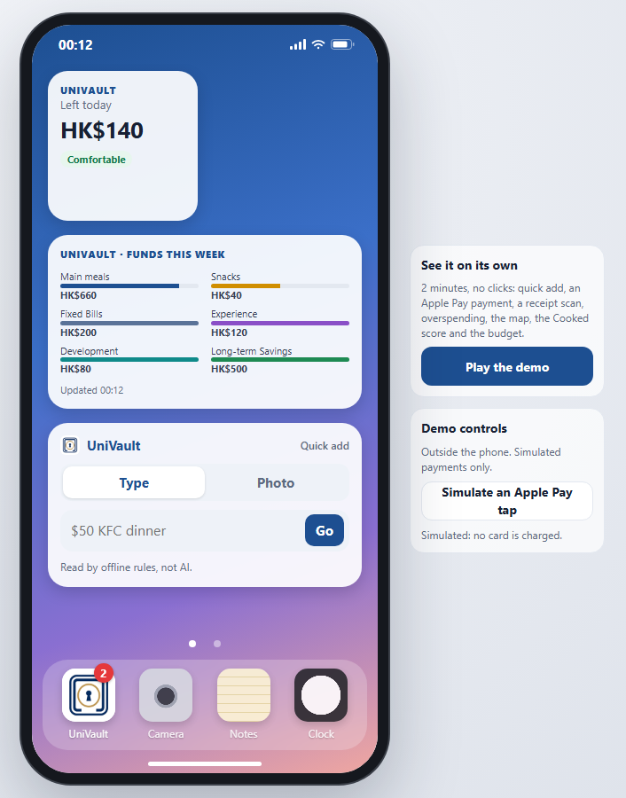
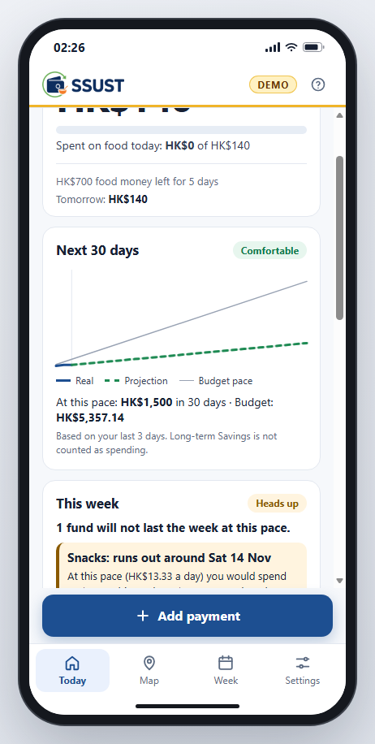
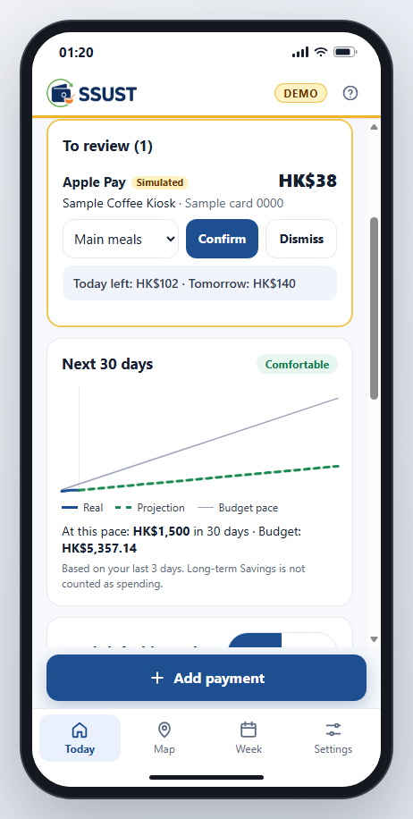
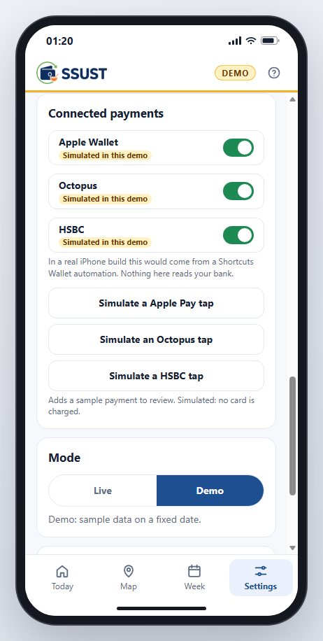
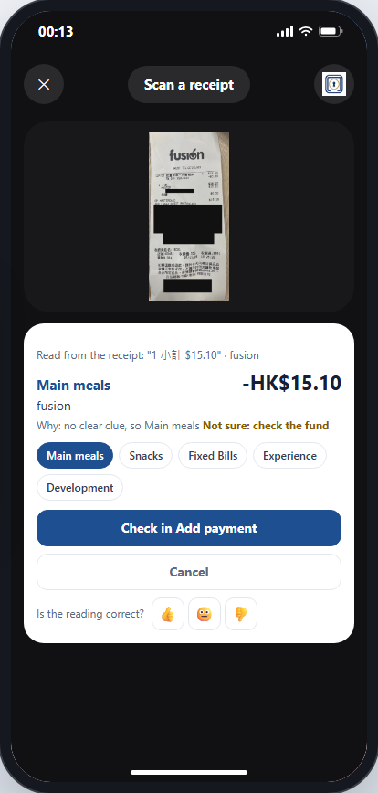
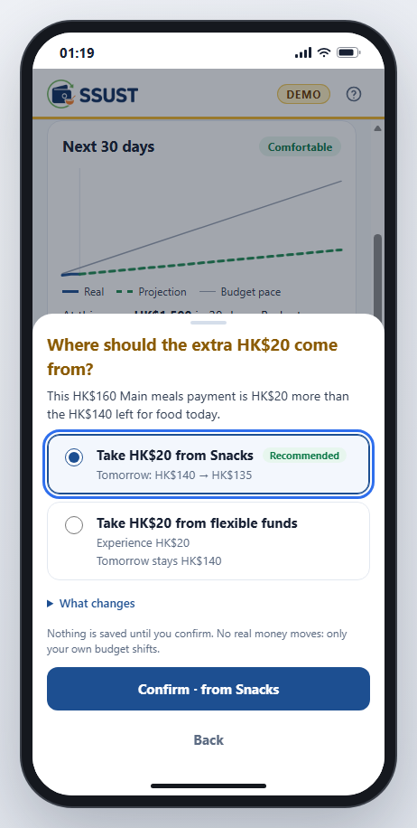
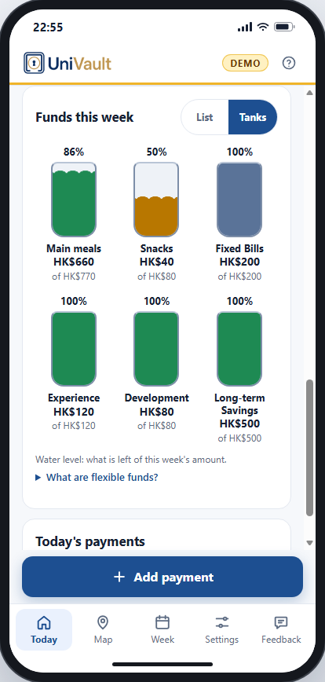
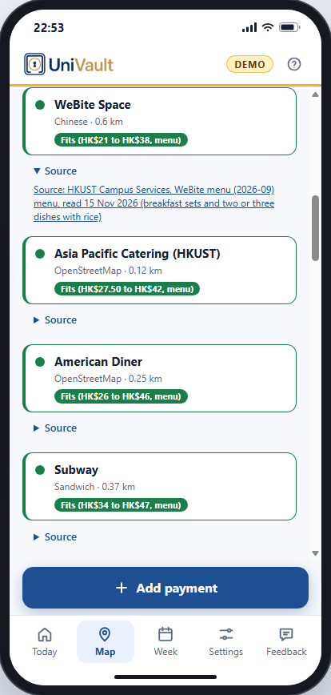
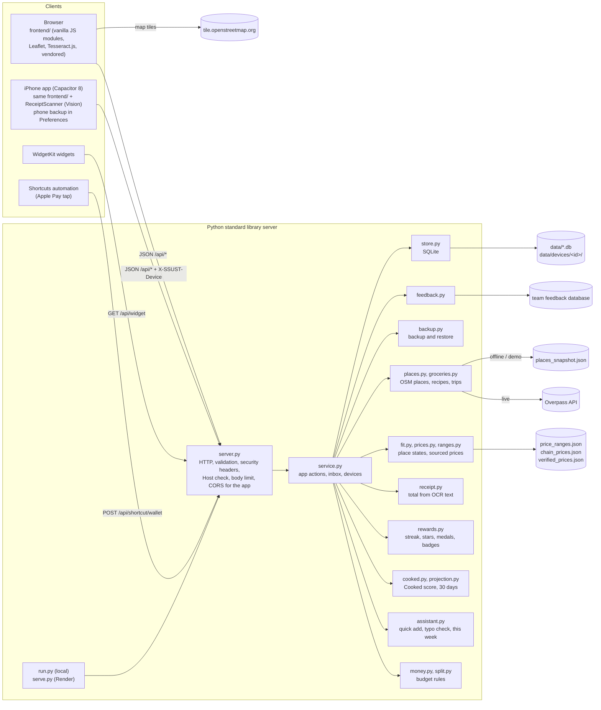
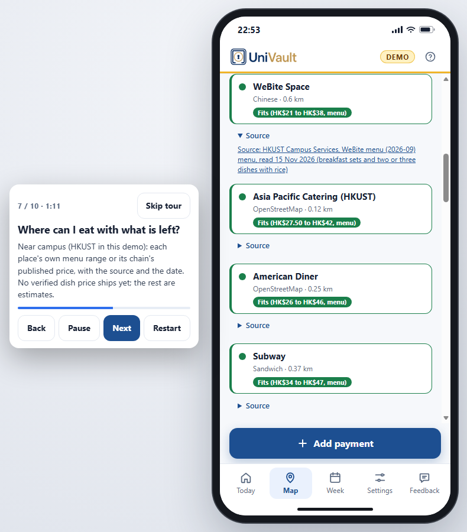

# UniVault: Smart Spending for Students

[](https://github.com/Viethoang18112007/SMBP-Finhack-JustMATH/actions/workflows/tests.yml)

**A weekly budget for university students in Hong Kong that tells you what you can spend on food today, and where near campus that money still buys a meal.** Built by team JustMATH for the Finance track of [SMBP FinHack](https://smbp-finhack.devpost.com/).

**Live demo:** <https://ssust-api.onrender.com> (Demo mode, sample week). It runs on Render's free plan, so after a quiet spell the first visit can take about a minute while the server wakes up. On a screen wider than 900 px the app sits inside a simulated phone. Press **Play the demo** beside the phone (or **Show me around** in the welcome card) and it runs on its own for 2 minutes through the main features: quick add, an Apple Pay payment arriving, a real receipt scanned, overspending, the map, the Cooked score and the budget.



## Try it on your iPhone (TestFlight)

1. On your iPhone (iOS 15 or later), install **TestFlight** from the App Store.
2. On the same iPhone, open <https://testflight.apple.com/join/KxvhjN2h> and tap **Accept**, then **Install**.
3. Open the app (its name on the home screen is **UniVault**) and set your weekly budget. It uses the hosted server, so the first launch after a quiet spell can take about a minute.
4. Optional: in **Settings > Apple Pay and widget**, copy the link and header into a Shortcuts automation ("When I tap any card in Wallet") so Apple Pay payments arrive in To review by themselves, and add the widget to your home screen (iOS 17 or later).

## What it does

You split your week's money into five funds (Main meals, Snacks, Fixed Bills, Experience, Development) plus Long-term Savings. Every number is integer HKD cents, and every rule is plain, tested code.

- **Today.** What is left to spend on food today: food money left at the start of today (Main meals plus Snacks) divided by the days left in the week, today included. Tomorrow's figure, a **Cooked score** (0 to 100, three plain rules: spending pace, funds running out, savings used), the **next 30 days** projection, **This week** warnings ("Snacks: runs out around Sat 14 Nov"), the funds as a list or as water tanks, today's payments with Undo, and **To review** for payments that came in from outside.
- **Add a payment, and what happens when it goes over.** A meal over today's money is covered in a fixed order: Snacks, then the flexible funds (Experience, then Development), then Long-term Savings last. Fixed Bills never covers anything. You see each choice with its before and after, nothing is saved until you confirm, and Undo puts every balance back exactly.
- **Quick add in plain words.** `$50 KFC dinner`, `奶茶 28`, `HK$12.5 coffee`: offline rules read the amount, pick the fund (chain names, then English and Chinese keywords) and say why. A typo check asks before saving an amount far above normal (`KFC dinner $500`).
- **Receipt scan.** In the iPhone app, the text is read on the phone by Apple's on-device text recognition (Vision, through the app's own `ReceiptScanner` plugin). In the browser, the vendored Tesseract.js reads it offline. Only the text goes to the server, which finds the total with tested rules. The form opens pre-filled; you check it and Save.
- **Apple Pay through a Shortcuts automation (iPhone).** A "When I tap any card in Wallet" automation posts the amount, merchant and card to `POST /api/shortcut/wallet`. The payment waits in To review with a fund already picked; nothing is spent until you confirm it.
- **Widgets.** A WidgetKit widget (small, medium, large and lock screen) reads `GET /api/widget`: what is left today, every fund, the last payments, the streak and what waits for review. A second widget is a quick type bar that opens the app ready to type. For iOS 16 and older, a Shortcuts widget reads one line from `GET /api/shortcut/today`.
- **Map: where can I eat with what's left?** Food places from OpenStreetMap around HKBU, HKUST, CUHK, HKU or CityU, compared with one meal's share of today's food money. Prices are sourced, never invented: 11 places near HKBU and HKUST carry a range read on their own official menu, 20 chains carry a published meal range, each with its source and the date; everything else is clearly marked as an estimate. A **Groceries** mode prices 15 simple recipes with the Consumer Council's Online Price Watch data and adds the trip.
- **Week.** Where the money went, the biggest day, top notes, last week to compare, and **Your progress**: a streak whose shape grows (square, star, diamond, hexagon, crown), 1 to 5 stars for last week's balance, campus medals (bronze, silver, gold for meals logged within budget at 3, 7 and 15 places) and 8 badges.
- **Settings.** The weekly budget with sliders and the suggested split (40/5/15/10/10/20), Live or Demo, Apple Pay and widget setup (iPhone), simulated connected payments (web demo), display, and Demo & help.
- **Feedback.** A 1 to 5 rating and a few words, sent privately to the team. The app never shows anyone's feedback.
- **Backup, restore and offline (iPhone).** The phone keeps a copy of all its data. When the free server has been wiped, the app restores it; when the server cannot be reached, the last saved numbers show read-only.
- **Guided tour and auto-play.** A 15 step tour with bubbles on the real screens (Live and Demo), and a 2:00 auto-play of the main story for presentations (Demo only).

## Screenshots

Taken from the real app in Demo mode (sample week, Wed 11 Nov 2026), inside the simulated phone shown on wide screens.

**Today.** HK$140 left to spend today, Scan a receipt, the streak, and the Cooked score (10 out of 100, Chill).



**Home screen widgets.** Right after quick add `$50 KFC dinner`: HK$90 left today, the six funds, and the quick add widget saying what it added.


**Apple Pay payments.** The demo copies a real Apple Pay payment (HK$18 at 7-Eleven, simulated in the web demo, with a sample card). It arrives as a notification, then waits on Today in To review with a fund picked from the merchant name and the reason (here: no clear clue, so Main meals) and the effect on today.






**Scan a receipt.** A real fusion receipt from HKUST (card and reference numbers covered) read offline in the camera screen: HK$15.10 from the subtotal, matched by the card line, the shop, the fund and why. "Check in Add payment" opens the form pre-filled.



**When a payment goes over.** A HK$160 main meal is HK$20 more than the HK$140 left today, so UniVault asks where the extra comes from. Nothing is saved until you confirm; it only moves budget between your own funds.



**Fund tanks.** The six balances of the sample week as water levels.



**Map: where can I eat with what's left.** Around HKUST, places with a range read on their own menu say "Fits (HK$21 to HK$38, menu)", with the source and the date it was read.



**Weekly budget.** Money for this week with its slider, the total funds bar, and each fund in % or HK$ with its own slider and the suggested split.


## Run it

You need **Python 3.12** (the version CI tests). Nothing else: the backend uses only the Python standard library, so there is **no `pip install`** step.

```sh
git clone https://github.com/Viethoang18112007/SMBP-Finhack-JustMATH.git
cd SMBP-Finhack-JustMATH
git checkout ssust-app
python run.py           # your own data, today's real date
python run.py --demo    # sample week on a fixed date (Wed 11 Nov 2026), works offline
```

On macOS and Linux, use `python3` if `python` is not Python 3. On Windows you can also double-click `run.bat`.

`run.py` starts the server at <http://127.0.0.1:8765> and opens a browser tab. Press **Ctrl+C** to stop it. It works from any folder.

| Option | Meaning |
| --- | --- |
| `--port N` | Port to listen on (default 8765, `0` picks a free port) |
| `--data DIR` | Folder for the database files (default `data/` next to `run.py`) |
| `--demo` | Start in demo mode on the sample week |
| `--no-browser` | Do not open a browser tab |
| `--feedback-url URL` | Where feedback goes (default: the team's online feedback database; `local` keeps it in `data/`). Also `SSUST_FEEDBACK_URL`. Only feedback leaves your computer |
| `--export-feedback FILE` | Write the locally kept feedback to a CSV file and exit |

### Live and demo

The header always shows which mode you are in: an amber **Demo** chip, or a quiet **Live** one. The switch itself is in **Settings > Mode**.

- **Live** uses today's date in Hong Kong (Asia/Hong_Kong, whatever your computer's time zone) and your own data, stored in `data/ssust.db`. The first launch starts at zero and Today is a one-screen setup. A new week starts at Monday 00:00 Hong Kong time; each week has its own opening amounts, pre-filled from last week. Past weeks stay readable (read-only) on the Week screen.
- **Demo** uses a sample week on a fixed date, stored separately in `data/ssust-demo.db`. Switching to demo always restarts the sample week. Demo data never mixes with live data.

To reset, stop the app and delete the file(s) in `data/`.

### The hosted demo (Render)

`serve.py` runs the same app on a hosting platform: it listens on every interface, on the port the platform gives in `PORT`, and trusts the public host name (`RENDER_EXTERNAL_HOSTNAME`, or more names in `SSUST_PUBLIC_HOSTS`, comma separated) in the Host check. It starts in demo mode (`SSUST_MODE=live` for live). `render.yaml` describes one free web service, `ssust-api`, with no build step: on Render, choose **New > Blueprint** and pick this repository. To try it locally:

```sh
PORT=8000 python serve.py                       # macOS / Linux
$env:PORT = "8000"; python serve.py             # Windows PowerShell
```

Everyone who opens the public address shares the same data, and the free plan wipes the disk on every restart, so use it to show the demo, not to keep real spending. The free plan also sleeps after a while without visits; the first visit then takes about a minute. The iPhone app uses this same server.

## Running the tests

From the repository root, on any OS:

```sh
python -m unittest discover -s backend/tests -t backend -v
```

The suite (1029 tests) covers the money rules, input validation, dates, the SQLite store, the service layer, places, prices and budget fit, receipts, rewards, backup and restore, the wallet and widget endpoints, the HTTP API on a real server, the launchers (including a real `run.py` process), the frontend files, the demo timeline and this README. No test touches the network or your `data/` folder. GitHub Actions runs it on Ubuntu and Windows on every push and pull request to `ssust-app`.

A smoke test starts UniVault on a free port with an empty, temporary data folder and checks every file the page loads and every endpoint the widgets use:

```sh
python scripts/smoke_fresh_clone.py           # this folder, as it is on disk
python scripts/smoke_fresh_clone.py --clone   # a fresh git clone of the last commit
```

## The iPhone app (Capacitor, Codemagic, TestFlight)

The same `frontend/` folder runs inside an iOS app made with **Capacitor 8** (Swift Package Manager). This is only for the iOS build: the web app and the backend need no npm and no build step.

- `package.json` and `capacitor.config.json` (app id `com.adamattar.ssust`, web folder `frontend`) describe the shell; `ios/` is the Xcode project. It adds the `ReceiptScanner` plugin (`ios/App/App/ReceiptScanner.swift`, Apple Vision text recognition in English, Traditional and Simplified Chinese) and the widget extension (`ios/App/SSUSTWidget`).
- After changing `frontend/`, run `npx cap sync ios` (Node 22 or later) to copy it into the iOS project.
- **Build:** `codemagic.yaml` has one workflow, **`ios-testflight`**, on a Codemagic Mac mini M2: `npm ci`, `npx cap sync ios`, automatic code signing through the App Store Connect integration (no key, certificate or profile is stored in this repository), a build number one above the latest TestFlight build, `xcode-project build-ipa`, then upload to App Store Connect. Internal testers get every build on **TestFlight**; external beta review is requested by hand. Anyone can join the beta with the public link in [Try it on your iPhone](#try-it-on-your-iphone-testflight).
- Inside the app there is no phone frame and no demo. API calls go to the hosted server (`NATIVE_API_BASE` in `frontend/js/config.js`, the Render service `ssust-api`). Each phone sends a random id of its own (`X-SSUST-Device`) and gets its own data on the server (`data/devices/<id>/`, at most 200 phones per server). The server answers the app origin (`capacitor://localhost`) with CORS headers on `/api/` only; every other origin gets none.

**Apple Pay (Shortcuts).** Settings > **Apple Pay and widget** gives the URL and this phone's header to paste into a Shortcuts automation ("When I tap any card in Wallet" > Get Contents of URL, POST, JSON `amount`, `merchant`, `card`). The amount is read from text like "HK$38.00" or a JSON number, always into integer cents. Bank cards in Apple Pay are fully automatic: amount, merchant and card arrive by themselves. **Octopus is not:** iOS gives Shortcuts no amount for a transit card tap, so UniVault keeps it in To review as "Octopus tap at hh:mm | amount?" and you type the amount (Confirm needs an amount above zero and runs the usual typo check). iOS can fire the automation twice for one tap, so taps of the same card on the same phone within 2 minutes are one item, and a later message with the amount fills it in. A run with every field empty is the play-button test ("Test run: the link works"). Settings shows which fields the last message carried (names only, never the amount or the merchant). Manual check: [docs/OCTOPUS_TEST.md](docs/OCTOPUS_TEST.md).

**Widgets (WidgetKit, iOS 17+).** The UniVault widget reads `GET /api/widget` with this phone's id, which the app hands over through the App Group `group.com.adamattar.ssust`, so nothing is pasted. The app asks the widget to refresh when today's numbers change; the widget also refreshes about every 30 minutes and keeps the last answer for when the server sleeps. The **Quick type** widget opens the app through `ssust://quick` on a typing sheet with the field focused.

## Your data and the backup

- **Web app (`run.py`).** Your budget, payments and everything else stay on your computer, in SQLite files under `data/` (`ssust.db` for Live, `ssust-demo.db` for Demo). Only feedback leaves it (see Feedback below).
- **Hosted demo (`serve.py` on Render).** Shared by every visitor, wiped on every restart.
- **iPhone app.** The server runs every budget rule, but its data is a cache that can be rebuilt: **the copy on the phone is the backup**. After each burst of changes and at each app open, the app reads `GET /api/backup` (budget weeks, payments, To review, campus, Apple Pay status, map meals, feedback; streak, stars, medals and badges are computed from those) and keeps it with the time and the phone's id in Capacitor Preferences, which iOS keeps until the app is deleted.
- **Restore.** When the server answers that it has nothing for this phone (`"fresh": true` in the state), or a backup shows fewer rows than the copy, the app sends the copy back with `POST /api/restore` and shows "Your data was restored from this phone." The restore merges in one transaction: rows already on the server stay, missing ones are added, nothing is counted twice, so an Apple Pay payment that arrived while the server was empty stays in To review.
- **Offline, read-only.** At launch the app pings `GET /api/ping` to wake the server. If it has not answered within about 3 seconds, or cannot be reached, the last saved numbers show read-only under "Offline, last updated hh:mm" until it answers. Reading a receipt still works meanwhile.
- **No accounts, no third party.** The phone's random id is the only link between the phone and the server. If the app is deleted, its copy and its id go with it. Manual checks on a real iPhone: [docs/RESTORE_TEST.md](docs/RESTORE_TEST.md). A paid disk (set `SSUST_DATA` to it) would keep the server data too.

## Architecture



| Module | Role |
| --- | --- |
| `run.py` | Local launcher: options, starts the server on 127.0.0.1, opens the browser, Ctrl+C stops it |
| `serve.py` | Hosted launcher (Render): settings from environment variables, listens on every interface |
| `backend/ssust/server.py` | Thin HTTP layer: routes, request checks, static files from `frontend/`, security headers, Host check, 4 KB body limit (1 MB for restore), CORS for the iOS app only |
| `backend/ssust/service.py` | App actions: state, mode, funds, payments, campus, places with budget fit, receipts, inbox (To review), wallet taps, widget, per-phone data |
| `backend/ssust/money.py` | Budget rules (allowance, cover options, week close), pure functions |
| `backend/ssust/split.py` | Fund split rules for the sliders (always 100%, integer cents), mirrored in `frontend/js/split.js` |
| `backend/ssust/assistant.py` | Quick add in plain words, fund picking with a reason, typo check, this week's pace and insights; offline rules |
| `backend/ssust/cooked.py` | Cooked score from three rules |
| `backend/ssust/projection.py` | 30 day spending projection and its status |
| `backend/ssust/rewards.py` | Streak and its shape, last week's stars, campus medals and badges |
| `backend/ssust/receipt.py` | Finds the total and a merchant in OCR text |
| `backend/ssust/fit.py` | Price ranges, honest place states and their order |
| `backend/ssust/prices.py`, `ranges.py` | Verified dish prices, chain prices and menu ranges: strict loading and matching to map places |
| `backend/ssust/places.py` | Campuses, OpenStreetMap fetch and filter, offline snapshot |
| `backend/ssust/groceries.py` | Recipes, Price Watch prices, trip cost, store comparison |
| `backend/ssust/backup.py` | The phone backup document and the merge on restore |
| `backend/ssust/feedback.py` | Feedback checks, outbox and delivery |
| `backend/ssust/store.py` | SQLite storage (payments, undo, inbox, meals logged at a place, feedback), integer cents only |
| `backend/ssust/dates.py`, `validate.py` | Week dates and clocks (Hong Kong time, fixed demo clock); parsing of amounts and notes |
| `frontend/` | Vanilla HTML, CSS and JavaScript modules, no build step |
| `ios/`, `codemagic.yaml` | The iOS shell, its plugin and widgets, and the TestFlight build |

## Budget rules

All money is stored and computed as **integer cents**, never floating point (rounding too is done in integers). Conversion to HK$ happens only when a number is shown.

- **Funds** may be 0 (for example no snack budget this week). Amounts are typed like `120`, `45.50` or `1,234.50`; at most two decimals, a dot as the decimal mark. A comma is only a thousands separator, so `12,50` is refused rather than read as HK$1,250.
- **Payments** must be more than HK$0.
- **Editing a fund mid-week (live):** the payments stay, so a fund cannot be set below what this week's payments already took from it. The server refuses it with the lowest allowed amount, shown next to the field. In demo, new numbers start a fresh demo week instead.
- **Undo:** any payment of the current week can be undone (Undo, then "Yes, undo"). Balances are always recomputed from the payments that still count, so a reallocation the payment caused is reversed too, and today's and tomorrow's allowances go back to their exact earlier values. There is no edit: to correct a payment, undo it and enter it again. Past weeks are read-only.
- **No double payments:** each submit carries a request id. Sending the same request again (double click, retry after a network error) never records a second payment.

### Setting the weekly budget

You type (or slide) the **money for this week**, then split it across the six funds, as a percent, an HK$ amount, or with its slider. Once there is a total, the six funds always add up to exactly that total, to the cent: moving one fund moves the others in proportion, and the lock icon keeps a fund fixed. **Use suggested split** goes back to:

| Fund | Suggested | Suggested minimum |
| --- | --- | --- |
| Main meals | 40% | 25% |
| Snacks | 5% | none |
| Fixed Bills | 15% | none |
| Experience (flexible) | 10% | none |
| Development (flexible) | 10% | none |
| Long-term Savings | 20% | 10% |

A fund below its suggested minimum gets a warning, not a block: the student decides. The split lives in `money.SUGGESTED_SPLIT` and `money.MIN_SPLIT`.

### Daily food allowance

> **Daily allowance = food money left at the start of today ÷ days left in the week (today included)**

"Food money" is Main meals + Snacks. Example: HK$700 left on Wednesday morning with 5 days to go (Wed to Sun) gives HK$140 for today. The allowance is fixed for the day; what you spend today is taken from it. Tomorrow's figure is shown too, so you can see the effect of a payment before you make it. At 80% of today's allowance, the app shows a gentle notice.

### When a payment goes over

- **Main meal or snack** over today's allowance: the gap is covered in this order:
  1. **Snacks** (what is left in the snack fund),
  2. **Experience, then Development** (the flexible funds),
  3. **Long-term Savings**, only when the funds above cannot cover it.

  When more than one cover is possible, the app asks you to choose and shows each fund before and after.
- **Experience or Development** over its own fund: the other one of the two, then savings.
- **Fixed Bills never use another fund.** A fixed bill is paid from the fixed fund only; anything above it is recorded as uncovered.
- If even savings cannot cover a payment, it is refused.

When a week ends, whatever is left in the flexible funds moves to **Long-term Savings** (`money.week_close`), together with what is left of the week's own savings.

## How cooked are you?

Today opens with a **Cooked score** from 0 to 100 (`backend/ssust/cooked.py`), plain integer rules on your own numbers. Tap the gauge to see its three factors:

| Factor | Points | Rule |
| --- | --- | --- |
| Spending pace | 0 to 50 | projected 30 day spending as a % of the 30 day budget: 1 point per whole % above 80% |
| Funds running out | 0 to 30 | 10 points per fund that will not last until Sunday at this week's pace |
| Savings used | 0 to 20 | share of this week's Long-term Savings already used to cover overspending (half or more: 20) |

Levels: **Chill** (under 20), **Fine** (under 40), **Sweating** (under 60), **Cooked** (under 80), **Well done** (80 and up). Under it, the **Next 30 days** curve marks where the projection passes the budget line ("HK$0 around Thu 12 Nov at this pace").

**30 day projection** (`backend/ssust/projection.py`): the average per day over the last 14 days (or all days if fewer), carried over the next 30 days, against the budget pace (the five spending funds of this week / 7 per day; Long-term Savings is not spending). **Comfortable** up to 90% of the pace, **On track** up to 105%, **Spending too fast** above. With fewer than 2 days of data there is no projection.

## Rewards

- **Streak with a shape:** days in a row with at least one payment logged. Square (1 day), star (3), diamond (7), hexagon (14), crown (30). It stays alive until today ends. Shown on Today, in the camera screen and on Week.
- **Stars for last week:** 1 to 5 stars for how the last finished week was balanced. 1: some spending had nothing to cover it. 2: Long-term Savings had to cover spending, or nothing was left. 3: money was left (also the most a week with a reallocation between funds can get). 4: at least 10% of the spending budget left. 5: at least 20% left.
- **Campus medals:** on the Map, tap a place, then **Log a meal here**. Bronze at 3 different places near a campus, silver at 7, gold at 15. A meal only counts when it fit that day's food money, so the medal rewards eating well within budget, not eating out more.
- **Badges:** First entry, Planner, On a roll (3 days), Full week (7 days), Money left (3 stars), Five stars, Saver (HK$500 in Long-term Savings), Smart explorer (a bronze medal). On Week, under Your progress.

## Scan a receipt

1. **In the iPhone app**, the iPhone's scan screen crops and straightens the receipt, then Apple's on-device text recognition reads it (`ReceiptScanner` plugin). Each line comes back with its position, so `frontend/js/rows.js` puts a label and its amount back on one line. No photo leaves the phone. A folded **What the phone read** shows the text, and a failed scan says which step failed. Checks on a real iPhone: [docs/RECEIPT_SCAN_TEST.md](docs/RECEIPT_SCAN_TEST.md).
   **On the web**, a photo or screenshot is read in the browser, offline, by the vendored Tesseract.js (English and Traditional Chinese), loaded only when needed. Borders are cut off, the image is enlarged, and if the first reading finds no sure total, more readings run within about 10 seconds (the price column alone, the whole receipt as one block, scattered text, the photo turned sideways).
2. Only the text goes to `POST /api/receipt/parse`. `backend/ssust/receipt.py` finds the total with tested rules: TOTAL, GRAND TOTAL, AMOUNT DUE, 應付, 總計, 合計, 總額; then AMOUNT, AMT, 金額; a card or wallet line confirms the amount paid; SUBTOTAL/小計 is only a fallback. Cash tendered, change (找續), tips, discounts and zero never count; dates, times, IDs, phone and card numbers are ignored. With no total line, a **best guess** to check is offered; with fewer than two prices read, the app asks you to retake the photo.
3. `assistant.parse_entry` picks the fund from the merchant, gives the reason, and runs the typo check.
4. Add payment opens **pre-filled** ("Read from receipt: check it"). **It never saves by itself.**

The camera screen has a **Samples** row (`frontend/img/samples/`) that goes through the same real OCR: a real fusion receipt photo (card and reference numbers covered) and six fictional receipts marked Sample.

## Where can I eat with what's left

The Map tab shows nearby food places from OpenStreetMap around a campus you choose: **HKBU, HKUST, CUHK, HKU or CityU** (default HKUST; saved separately for live and demo). Each place is compared with **one meal's share of today's food money**: what is left for food today divided by the meals still to come, by Hong Kong time (3 before 11:00, 2 before 16:00, then 1; demo mode is at noon). The map says both numbers ("HK$140 left for food today, 2 meals to go: about HK$70 a meal").

For one place, the most exact source wins: **verified dish price > the place's own menu range > its chain's price > estimate**.

| State | When |
| --- | --- |
| **Fits / Over budget** | a **verified** dish price (`verified_prices.json`, ships with no records) |
| **Fits / May fit / Over (HK$a to b, menu)** | the place's **own official menu range** (`price_ranges.json`): 3 places near HKBU and 8 near HKUST, read on 15 Nov 2026 |
| **Fits / May fit / Over (chain price)** | the **chain's published meal range** (`chain_prices.json`): 20 chains, about 260 places in the snapshot, all marked `needs_check` |
| **May fit / Likely over (estimate)** | no sourced price: a range from the OpenStreetMap price tag, else from the place type (fast food, food court and cafe up to HK$50; restaurant HK$50 to HK$120), always labelled "not a real menu price" |

An estimate never gets a "Fits" badge. Sources and dates sit under each row (tap **Source**). `python tools/check_prices.py` checks all three price files and exits with 1 if a record is rejected. Formats: `backend/ssust/data/VERIFIED_PRICES.md`, `backend/ssust/data/CHAIN_PRICES.md`; what was skipped and why: [docs/PRICE_RANGES_REPORT.md](docs/PRICE_RANGES_REPORT.md).

**Where the places come from.** Live mode asks the OpenStreetMap Overpass API and caches the answer, falling back to the offline snapshot on any failure. Demo mode only reads the snapshot, so it works without the internet. The screen always says which source is shown. The snapshot (`backend/ssust/data/places_snapshot.json`) holds the nearest 300 named food places and 300 shops within 10 km of each campus; regenerate it with `python tools/make_places_snapshot.py` (needs the internet).

### Groceries

The Map's **Groceries** mode shows supermarkets and convenience stores, 15 simple student recipes (`backend/ssust/data/recipes.json`), and prices only from the Consumer Council's **Online Price Watch** open data (`grocery_prices.json`, with the source and date). An ingredient not in Price Watch says **price unknown** and is left out of the total, never guessed. The trip is estimated from straight-line distance x 1.3: walking is free, taxi uses the Transport Department's urban meter table, MTR uses the MTR fare table (open data); bus fares are not checked. For two stores it says which is cheaper in total, trip included. Rules: `backend/ssust/groceries.py`.

## Guided tour and demo mode




- **Guided tour:** the **?** button in the header (or "Take the tour" in Settings > Demo & help). It works in Live and Demo and only moves between screens: it never saves anything. Fifteen steps: the widgets, today's money, the next 30 days, this week, the funds as tanks, adding a payment, the overspend step, undo, quick add, receipt scan, connected payments, Week, and the map.
- **Auto-play** (Demo only): **Play the demo** beside the phone, **Show me around** in the welcome card, or **Play the demo** in Settings > Demo & help. One timeline, 10 steps in exactly 2:00: today's HK$140 and the Cooked meter, quick add `$50 KFC dinner` (HK$90 left), a simulated Apple Pay notification (HK$18 at 7-Eleven), the review (HK$72 left), the real fusion receipt read offline and saved (HK$15.10, HK$56.90 left), the HK$160 overspend step and Undo, the map with menu and chain prices, the Cooked score across three demo weeks, the budget sliders, and an honest outro. The timeline lives in `frontend/js/demo-timeline.js`; [docs/DEMO_SCRIPT.md](docs/DEMO_SCRIPT.md) with timestamps and narration is generated from it (`python tools/demo_script.py --write`, which fails if the total is over 2:00). Pause, Back, Next, **Restart** and **Skip tour** are on the caption; add `?timer=0` to hide the corner timer.
- **Record mode:** open `/?record=1`. A pointer glides to each control before the same real click happens; captions stay as subtitles, the buttons and demo controls are hidden. Space starts a take, Esc stops it.
- **Safety:** auto-play refuses to start in Live and never auto-starts. It resets the demo week before it begins and again when it ends, is skipped, or stops because something failed. A reload in the middle of a run resets the demo week on the next load.
- **Phone view:** on screens wider than 900 px the app sits inside a generic phone frame with a status bar, a swipeable home screen with widgets, and its own simulated notifications (Settings > Display > Phone view turns it off). Elsewhere, the **Widgets** button in the header opens the same home screen full screen.

## API

`run.py` listens on `127.0.0.1` only; `serve.py` listens on every interface for the hosted demo. POST bodies are JSON (`Content-Type: application/json`, at most 4 KB; only `POST /api/restore` takes up to 1 MB). Errors come back as `{"error": "..."}` with status 400 (bad input) or 500 (anything else, without details). Routes marked "with `X-SSUST-Device`" use that phone's own data.

| Method and path | Body / query | Does |
| --- | --- | --- |
| `GET /api/state` | `?week=YYYY-MM-DD` (a past Monday, optional) | The current week (or a past week, read-only): mode, funds, payments, today's figures, fund tanks, campus, `fresh`, `rewards`, `projection`, `cooked`, `insights`, `inbox`, `connected` |
| `POST /api/mode` | `{"mode": "live" \| "demo", "scenario"?: "sample" \| "empty" \| "over" \| "cooked"}` | Switch mode; demo restarts the chosen demo week |
| `POST /api/settings` | `{"main": "770", "snack": "80", "fixed": "200", "experience": "120", "development": "80", "savings": "500"}` | Set this week's opening amounts (HK$ as text, 0 allowed). A refused field comes back as `{"error", "field", "minimum"?}` |
| `POST /api/payments` | `{"amount": "48", "category": "main", "note"?, "choice"?: "snack" \| "flex" \| "savings", "requestId"?, "place"?: {"id", "name"}}` | Add a payment. When it goes over, the answer has `needsConfirm` and the cover options; send it again with a `choice`. A `requestId` already used returns that payment with `"replayed": true` |
| `POST /api/payments/undo` | `{"id": 12}` | Undo one of this week's payments |
| `POST /api/campus` | `{"campus": "hkbu" \| "hkust" \| "cuhk" \| "hku" \| "cityu"}` | Save the campus for the current mode |
| `GET /api/places` | `?kind=food\|shop\|grocery&radius=0.5\|1\|3\|5\|10` | Places around the saved campus; food comes with `budget` and a `status`, `label`, `why` and source per place |
| `GET /api/insights` | | This week's pace warnings and breakdown |
| `POST /api/assistant/parse` | `{"text": "$50 KFC dinner"}` | `{"ok", "amount" (cents), "category", "note", "reason", "confident", "typo", "chain"}`. Reads only |
| `POST /api/receipt/parse` | `{"text": "<OCR text, at most 3500 characters>"}` | `{"found", "amount" (cents or null), "line", "merchant", "entry"}`. Reads only |
| `POST /api/shortcut/wallet` | `{"amount": "HK$38.00" or 38, "merchant"?, "card"?}` (with `X-SSUST-Device`) | Add a real Apple Pay payment to To review. No amount with a card or merchant: an amount-unknown item. Every field empty: 400, recorded as a test run |
| `GET /api/widget` | (with `X-SSUST-Device`) | JSON for the home screen widget: left today, the allowance, every fund, the last 3 payments, streak, items to review |
| `GET /api/shortcut/today` | (with `X-SSUST-Device`) | One line of plain text for the Shortcuts widget |
| `GET /api/backup` | (with `X-SSUST-Device`) | Everything stored for this phone: `format`, `schemaVersion`, `device`, `exportedAt`, `revision` and `tables`, money in integer cents |
| `POST /api/restore` | that document (with the same `X-SSUST-Device`, at most 1 MB) | Merge it back in one transaction; anything wrong refuses the whole document; restoring twice changes nothing. Answers `{"added", "state"}` |
| `GET /api/ping` | | `{"ok": true}`. Wakes a sleeping host; reads no data |
| `POST /api/connected` | `{"source": "apple_pay" \| "octopus" \| "hsbc", "on": true \| false}` | Switch a simulated payment source (web demo) |
| `POST /api/inbox` | `{"source", "amount", "merchant", "card", "externalId"}` | Add a simulated incoming payment to review; the same `externalId` is added once |
| `POST /api/inbox/confirm` | `{"id": 3, "category": "main", "choice"?, "amount"?, "typoChecked"?}` | Confirm it through the same logic as `/api/payments`. An amount-unknown item needs `amount` |
| `POST /api/inbox/dismiss` | `{"id": 3}` | Dismiss it; nothing is saved |
| `POST /api/feedback` | `{"rating"?: 1 to 5, "message"?: "<at most 500 characters>", "screen", "contextId"?, "deviceId"?}` | Send private feedback. The answer is only `{"ok", "id", "thanks"}` |
| `GET /api/groceries`, `POST /api/groceries/plan` | | Recipes and sources; a priced shopping list, the trip and the fit against Main meals. Reads only |
| `GET /api/admin/feedback` | header `Authorization: Bearer <SSUST_ADMIN_TOKEN>` | Team only: every entry. 404 when the variable is not set, 401 for a wrong token |

Categories are `main`, `snack`, `fixed`, `experience`, `development`. Every other path serves a file from `frontend/`.

## Feedback (private)

The **Feedback** tab takes a 1 to 5 rating and an optional message (at most 500 characters); small **Rate this** buttons rate a receipt reading, the This week card or a grocery estimate. Students only ever get "Thanks" back: no route returns feedback to the app.

What is sent: rating, message, screen, an optional context id, the app version and an optional anonymous browser id (32 random hex characters, which the student can untick). Never a name, an account, an amount, a fund or a payment. By default every computer, and the hosted server for the iPhone app, sends it to the team's online feedback database (a Supabase table whose public key can only add rows; setup in [docs/FEEDBACK_DATABASE.md](docs/FEEDBACK_DATABASE.md), address in `backend/ssust/data/feedback_hub.json`). Offline, it waits in `data/feedback.db` and goes at the next send or start; a delivery only counts when the receiver confirms it. `python run.py --feedback-url local` keeps it in your own `data/` instead; export it with `python run.py --export-feedback feedback.csv`. 

How the team reads feedback kept on a server (the hosted one, or a computer started with `--feedback-url local`):

1. **On that computer**, export everything to a spreadsheet file: `python run.py --export-feedback feedback.csv` (`--data DIR` if the data folder is not `data/`). Cells that start with `=`, `+`, `-` or `@` get a leading `'` so a spreadsheet never runs them.
2. **Through the server**, set a long random token before starting it (`SSUST_ADMIN_TOKEN`; on Render it is typed in the dashboard, never stored in the repository), then open `/admin/feedback` and paste the token. Scripts can call `curl -H "Authorization: Bearer $SSUST_ADMIN_TOKEN" http://127.0.0.1:8765/api/admin/feedback`.

Without `SSUST_ADMIN_TOKEN`, `/api/admin/feedback` and `/admin/feedback` answer 404. A wrong or missing token gets 401. The token is compared in constant time and never logged.

## Troubleshooting

Start with the smoke test (`python scripts/smoke_fresh_clone.py`, see [Running the tests](#running-the-tests)): it uses an empty temporary data folder, so your `data/` is never touched.

| What you see | Why, and what to run |
| --- | --- |
| The live demo takes a minute to open | The free Render plan was asleep. Wait for it to wake; `/api/ping` answers `{"ok": true}` once it is up. |
| The widgets show **No budget yet** | A fresh live database has no budget. Tap **Set my budget**, or try the sample week: `python run.py --demo`. |
| No phone frame, no home screen | The phone frame only shows when the browser window is wider than 900 px (901 px and up) and Settings > Display > Phone view is on. The **Widgets** button in the header opens the same home screen full screen. |
| `python: command not found` (macOS, Linux) | Use `python3 run.py` (3.12 is tested). |
| `Could not start on port 8765` | Something already uses that port. Run `python run.py --port 0` for any free port. |
| `Could not open the data folder ... newer` | The `data/` folder was written by a newer version. Run `python run.py --data data-new` for a separate folder. |
| `Untrusted host.` | Open <http://127.0.0.1:8765> or <http://localhost:8765>. |
| Receipt reading never finishes | The browser reader needs WebAssembly SIMD (Chrome, Edge, Firefox, Safari 16.4 or newer). Type the amount instead. |

## Credits

- **Map data:** © [OpenStreetMap contributors](https://www.openstreetmap.org/copyright), available under the [Open Database License (ODbL) 1.0](https://opendatacommons.org/licenses/odbl/1-0/). The offline snapshot is a derived database of OpenStreetMap data and is under the same licence; its attribution and fetch date are stored in the file. Map tiles © OpenStreetMap contributors.
- **Grocery prices:** Consumer Council, Online Price Watch (open data). **Fares:** Transport Department taxi fare table and the MTR fare table (open data). Sources and dates are in each data file.
- **tesseract.js 5.1.1** and tesseract.js-core 5.1.1, under the Apache License 2.0, with Tesseract English and Traditional Chinese language data (Apache License 2.0), vendored in `frontend/vendor/tesseract/` (licences and sources there).
- **[Leaflet](https://leafletjs.com) 1.9.4**, © 2010-2023 Vladimir Agafonkin, © 2010-2011 CloudMade, under the BSD 2-Clause License (vendored in `frontend/vendor/leaflet/`, licence in `frontend/vendor/leaflet/LICENSE`).
