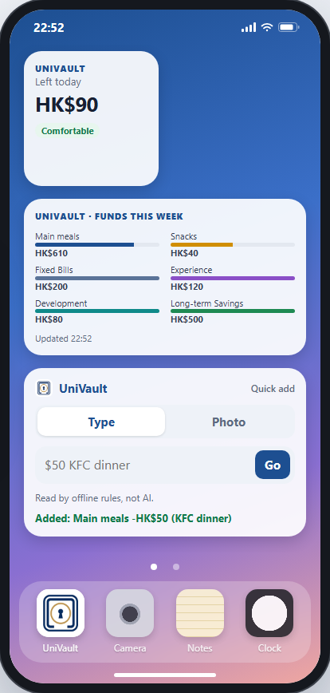
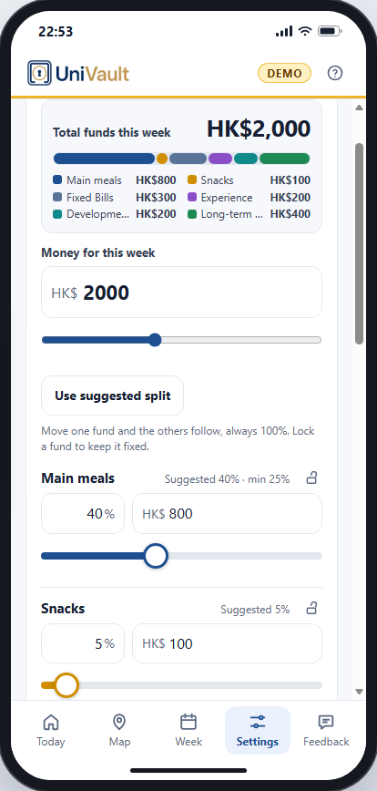
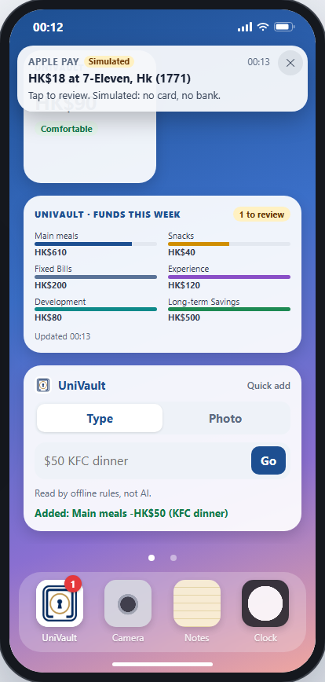
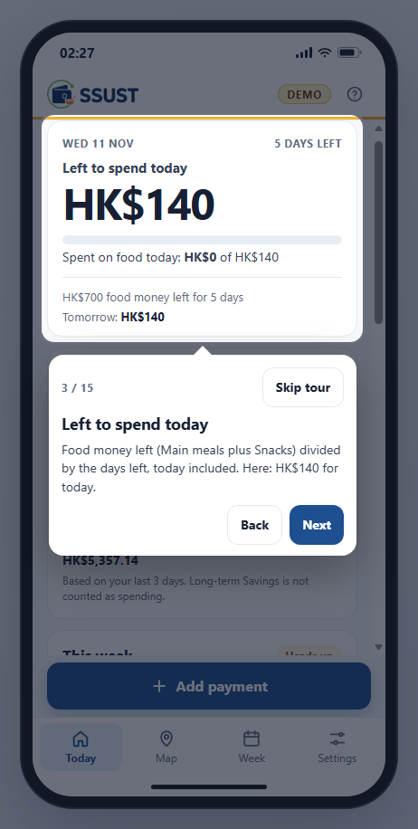
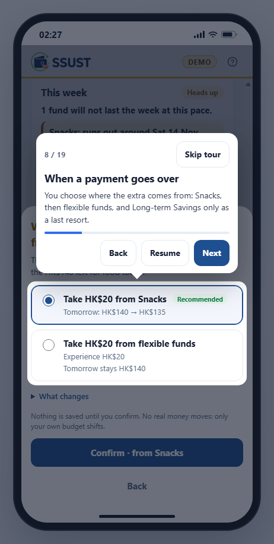
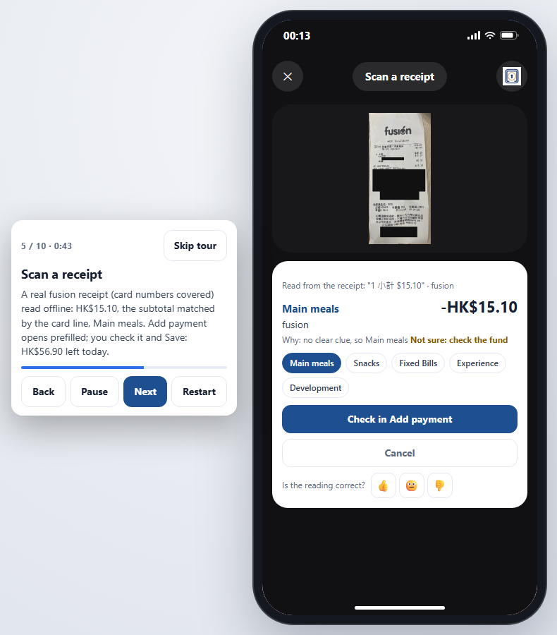
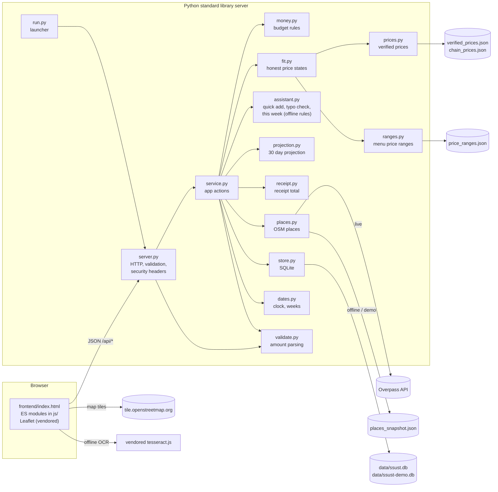

# SSUST: Smart Spending for Students

[](https://github.com/Viethoang18112007/HKBU-Hackathon-2.0-SSUST/actions/workflows/tests.yml)

A weekly budget app for university students in Hong Kong, built for BUHack 2.0 (FinTech track).

You split your week's money into five funds (main meals, snacks, fixed bills, experience, development) plus long-term savings. Each day SSUST tells you how much you can spend on food today, warns you before you go over, and when you do go over it shows you exactly which fund covers the gap. The map tab then answers a practical question: **where can I eat with what's left today?**

It runs on your own computer: no account, no bank connection, no cloud. Your data stays in a local SQLite file. On a wide screen the app is shown inside a simulated phone, with a home screen and widgets, for demos and videos.

## Screenshots and demo video

All screenshots are taken from the real app (demo week, Wed 11 Nov 2026) inside the simulated phone shown on wide screens.

**Today.** HK$140 left to spend today, the spent bar, tomorrow's amount, then **Next 30 days**: real spending (solid), the projection at your recent pace (dashed, coloured by status), the budget pace (thin grey) and a status pill in words. Right under it, **This week** warns before a fund runs out ("Snacks: runs out around Sat 14 Nov").


**Home screen widgets.** The small widget shows what is left today, the projection status and the time of the last update; the medium one adds the six funds and the number of payments to review; the large one is **quick add** (Type | Photo). They all read the same state as the app.



**Weekly budget.** Money for this week with its slider, the total funds bar, and each fund in % or HK$ with its own slider and the suggested split.



**When a payment goes over.** A HK$160 main meal is HK$20 more than the HK$140 left today, so SSUST asks where the extra comes from. Nothing is saved until you confirm, and nothing is lent: it only shifts budget between your own funds.


**Fund tanks.** The same six balances as water levels, after that meal with Experience covering the HK$20.


**Scan a receipt.** In the camera screen, a sample receipt image is read offline on the device: the total, the shop, the fund it picked and why. "Check in Add payment" opens Add payment pre-filled; nothing is saved until you tap Save.


**Connected payments, simulated.** A simulated Apple Pay tap arrives as a notification, then waits on Today in "To review" with a fund pre-selected and the reason.




**Map: where can I eat with what's left.** Around HKUST, places with a range read on their own menu say "Fits (HK$21 to HK$38, menu)", chains say "Fits (chain price)", each with its source and date; the rest stay estimates.


Demo video: https://youtu.be/dwNjo46av5E

## Quick start

You need **Python 3.12** (the version CI tests). Nothing else: the backend uses only the Python standard library, so there is **no `pip install`** step.

```sh
git clone https://github.com/Viethoang18112007/HKBU-Hackathon-2.0-SSUST.git
cd HKBU-Hackathon-2.0-SSUST
python run.py           # your own data, today's real date
python run.py --demo    # sample week on a fixed date (Wed 11 Nov 2026), works offline
```

On macOS and Linux, use `python3` if `python` is not Python 3. On Windows you can also double-click `run.bat`.

`run.py` starts the server at <http://127.0.0.1:8765> and opens a browser tab. Press **Ctrl+C** to stop it. It works from any folder.

| Option | Meaning |
| --- | --- |
| `--port N` | Port to listen on (default 8765, `0` picks a free port) |
| `--data DIR` | Folder for the database files (default `data/` next to `run.py`) |
| `--demo` | Start in demo mode on the sample week |
| `--no-browser` | Do not open a browser tab |

### Live and demo

The header always shows which mode you are in: an amber **Demo** chip, or a quiet **Live** one. The switch itself is in **Settings > Mode**.

- **Live** uses today's date in Hong Kong (Asia/Hong_Kong, whatever your computer's time zone) and your own data, stored in `data/ssust.db`. The first launch starts at zero: the weekly total and every fund are HK$0, "Left to spend today" shows HK$0, and Today is a one-screen setup. The suggested split only fills the funds once you type (or slide) a weekly total above HK$0; "Use suggested split" also works at any time. A new week starts at Monday 00:00 Hong Kong time. Each Monday-to-Sunday week has its own opening amounts; a new week asks for them again and pre-fills last week's. Past weeks stay readable (read-only) on the Week screen.
- **Demo** uses a sample week on a fixed date, stored separately in `data/ssust-demo.db`. The step-by-step demo script is in [docs/DEMO_SCRIPT.md](docs/DEMO_SCRIPT.md). Switching to demo always restarts the sample week. Demo data never mixes with live data.

To reset, stop the app and delete the file(s) in `data/`.

### Put it online (Render)

`serve.py` runs the same app on a hosting platform: it listens on every interface, on the port the platform gives in `PORT`, and trusts the public host name (`RENDER_EXTERNAL_HOSTNAME`, or more names in `SSUST_PUBLIC_HOSTS`, comma separated) in the Host check. It starts in demo mode (`SSUST_MODE=live` for live). `render.yaml` describes one free web service with no build step: on Render, choose **New > Blueprint** and pick this repository.

Everyone who opens the public address shares the same data, and the free plan wipes the disk on every restart, so use it to show the demo, not to keep real spending. The free plan also sleeps after a while without visits; the first visit then takes about a minute.

### iOS app (TestFlight)

The same `frontend/` folder can also run inside an iOS app made with Capacitor 8 (Swift Package Manager). This is only for the iOS build: the web app and the backend above still need no npm and no build step. `package.json` and `capacitor.config.json` (web folder `frontend`) describe the shell, `ios/` is the generated Xcode project, and `codemagic.yaml` builds it on a cloud Mac and sends it to TestFlight. Inside the app there is no simulated phone frame or home screen, and API calls go to the hosted server set in `frontend/js/config.js` (`NATIVE_API_BASE`, the Render service `ssust-api` from `render.yaml`). On the web that base is empty, so nothing changes. The server answers that one app origin (`capacitor://localhost`) with CORS headers on `/api/` only (GET and POST, no credentials); every other origin gets none, and the Host check, body limit and validation stay the same. After changing `frontend/`, run `npx cap sync ios` (Node 22 or later) to copy it into the iOS project.

The app has **no demo**: no Live/Demo switch, no sample weeks, tour, simulated taps or notifications. Each phone sends a random id of its own (`X-SSUST-Device`, kept in the app's storage) and gets its own live data on the server (`data/devices/<id>/`, at most 200 phones per server). Requests without that header (the web app) use the shared data exactly as before. The header leaves room for the status bar and the home indicator, and a double tap on an empty area no longer zooms. **Camera:** Today has **Scan a receipt** (camera or photos, then the same receipt reading as Add payment); the app declares the camera and photo permissions iOS asks for.

**Real Apple Pay payments (Shortcuts):** Settings > **Apple Pay and widget** gives the URL and this phone's header to paste into an iOS Shortcuts automation ("When I tap any card in Wallet" > Get Contents of URL, POST, JSON `amount`, `merchant`, `card`). Each Apple Pay payment then waits in Today under **To review** (marked Apple Pay, not Simulated); nothing is spent until you confirm it. The amount is read from text like "HK$38.00" or a JSON number, always into integer cents.

**Widget (Shortcuts):** the same page explains a shortcut that reads `GET /api/shortcut/today` (one line such as "SSUST: HK$82.29 left today · 3 day streak · 1 to review") and shows it; iOS can put that shortcut on the home screen as a widget, and a tap shows the line. A native WidgetKit widget is not built: it needs a Swift extension target, an App Group and more signing profiles that cannot be built or checked here without a Mac.

On Render's free plan the disk is wiped when the service restarts or sleeps, so app data does not last there; a paid disk (set `SSUST_DATA` to it) would keep it.

## Rewards and feedback

- **Streak with a shape:** days in a row with at least one payment logged. The shape changes as it grows: square (1 day), star (3), diamond (7), hexagon (14), crown (30). It stays alive until today ends. Shown on Today, in the camera screen and on Week.
- **Stars for last week:** 1 to 5 stars for how the last finished week was balanced. 1: some spending had nothing to cover it. 2: Long-term Savings had to cover spending, or nothing was left. 3: money was left (also the most a week with a reallocation between funds can get). 4: at least 10% of the spending budget left. 5: at least 20% left. Long-term Savings is not spending.
- **Badges:** First entry, Planner, On a roll (3 days), Full week (7 days), Money left (3 stars), Five stars, Saver (HK$500 in Long-term Savings), Smart explorer (a bronze medal). On Week, under Your progress.
- **Campus medals:** on the Map, tap a place, then **Log a meal here** (it opens Add payment with the place). Bronze at 3 different places near a campus, silver at 7, gold at 15. A meal only counts when it fit that day's food money, so the medal rewards eating well within budget, not eating out more. Undoing the payment removes it.
- **Feedback** (the last tab): 1 to 5 stars and a few words, saved on the server, with the latest feedback listed below.

## Phone view, sliders and the 30 day projection

- **Phone view.** On screens wider than 900 px the app sits inside a generic phone frame (status bar with the Hong Kong time, a home screen, and a home bar). The home screen swipes **left and right** like a phone: page 1 holds the widgets (quick add included), page 2 the apps, with page dots and a dock that keeps the SSUST icon on every page. Swipe on a touch screen, drag with the mouse, use the arrow keys or tap a dot. Tap the SSUST icon to open the app; the home bar goes back. Settings > Display > **Phone view** turns it off (remembered in the browser). On a real phone the app is full screen as before.
- **Sliders.** The weekly total has a slider (HK$10 steps, 0 to the larger of HK$5,000 and twice the total), and so does each fund (HK$10 steps, 0 to the weekly total), synced with the fund's % and HK$ fields. Typing more is allowed. In Live, a fund can't go below what it already paid for this week. A stacked **total funds bar** at the top of the budget card shows the week split by fund and follows every change live. Add payment has a slider (HK$1 steps) and quick amounts HK$20 / 35 / 50 / 80; the preview line follows.
- **30 day projection** (`backend/ssust/projection.py`). From every payment that still counts: real cumulative spending per day since the first payment, the average per day over the last 14 days (or all days if fewer), and the next 30 days at that average. The budget pace is the five spending funds of this week / 7 per day (Long-term Savings is not spending). Status: **Comfortable** if the projected 30 days are at most 90% of pace x 30, **On track** up to 105%, **Spending too fast** above (`STATUS_PCT`, exact integer comparisons). With fewer than 2 days of data there is no projection ("Projection starts after 2 days of use").

## How cooked are you?

Today opens with a **Cooked score** from 0 to 100 (`backend/ssust/cooked.py`), plain integer rules on your own numbers, not AI. Tap the gauge to see its three factors:

| Factor | Points | Rule |
| --- | --- | --- |
| Spending pace | 0 to 50 | projected 30 day spending as a % of the 30 day budget: 1 point per whole % above 80% |
| Funds running out | 0 to 30 | 10 points per fund that will not last until Sunday at this week's pace |
| Savings used | 0 to 20 | share of this week's Long-term Savings already used to cover overspending (half or more: 20) |

Levels: **Chill** (under 20, green), **Fine** (under 40), **Sweating** (under 60, orange), **Cooked** (under 80, red), **Well done** (80 and up, dark red). Under it, the **Next 30 days** curve marks where the projection passes the budget line: "HK$0 around Sat 14 Nov at this pace". The projected total and the method sit under **Numbers**, one tap away.

## Scan a receipt

There is one pipeline, used by **Scan receipt** in Add payment and by the **camera screen** (quick add widget > Photo):

1. A photo or screenshot (the shutter and the gallery button open the file picker; on a phone the shutter asks for the camera) is read in the browser, offline, by the vendored tesseract.js (English and Traditional Chinese), loaded only when needed.
2. The text goes to `POST /api/receipt/parse`. `backend/ssust/receipt.py` finds the total with tested rules: lines with TOTAL, AMOUNT DUE, GRAND TOTAL, 合計, 總數, 總計 or 應付 win (the last one), SUBTOTAL/小計, CHANGE, CASH, TIP and the remaining Octopus value never count, and dates, times, phone and card numbers are ignored. It also guesses the merchant.
3. `assistant.parse_entry` picks the fund from the merchant (chain names first, then keywords), gives the reason, and runs the typo check.
4. Add payment opens **pre-filled** and highlighted ("Read from receipt: check it", with the fund's reason). **It never saves by itself**: you check it and Save as usual, overspend step included.

OCR can misread, which is why you always confirm. The camera screen has a **Samples** row of six sample receipt images (`frontend/img/samples/`), all marked Sample on the image, that go through the same real OCR: three fictional shops (also in [docs/samples/](docs/samples/)) and three sample receipts for McDonald's, TamJai SamGor and HKUST Bookstore with demo amounts.

## Notifications (simulated)

Inside the phone frame SSUST shows its own notifications, offline and without any OS permission. A **banner** slides down from the top of the screen and hides after about 4 seconds; close it with its X, Escape or a swipe up, or tap it to open the screen it is about. Tap the **status bar** (or swipe down from it) for the **notification centre**, with every notification of the session and **Clear all**. The SSUST icon shows the **unread count** in a red badge. Five triggers, each shown once (remembered in the browser): a simulated connected payment (opens "To review"), a fund that will run out before Sunday at this pace, "Spending too fast" when the 30 day projection turns red, a week closed with its flexible leftovers moved to Long-term Savings, and a daily allowance reminder. The auto-play fires each one by name at a fixed time.

## Connected payments (simulated)

Real Apple Wallet, Octopus or bank access is not available to this project (Apple's FinanceKit does not cover Hong Kong and needs a special entitlement; Octopus and HSBC have no public API for individuals). Settings > **Connected payments** (folded, marked **Simulated**) shows how it would work: switch on Apple Wallet, Octopus or HSBC, then **Simulate a tap** (in that card, in Demo & help, or beside the phone on desktop). A sample payment with a fictional merchant goes into a real server inbox (`inbox` table, schema v4, idempotent by an external id) and a notification slides in from the top of the phone. Today shows **To review (n)**: Each item comes with a fund pre-selected: the one you used last time at that merchant, else `assistant.parse_entry`'s guess from the merchant name, with its reason shown ("coffee", "used last time at this merchant"). The typo check runs before Confirm too: an amount far above normal shows "Typo?" and the button becomes "Confirm HK$X anyway". Confirm runs exactly the same payment logic as Add payment (overspend step included) and remembers the fund per merchant for next time; Dismiss saves nothing; a confirmed one can be undone like any payment. In a real iPhone build this would come from a Shortcuts Wallet automation. Nothing here reads a bank.

## Guided tour and demo mode

SSUST has a guided tour with speech bubbles that point at the real screen, and an auto-play demo for presentations.








- **Guided tour:** press the **?** button in the header (or "Take the tour" in Settings > Demo & help). It works in LIVE and DEMO and only moves between screens: it never saves anything. Fifteen steps: the widgets, today's money, the next 30 days, this week, the funds as tanks, adding a payment, the overspend step, undo, quick add, receipt scan, connected payments, Week, and the map.
- **Auto-play** (DEMO only): press **Show me around** in the welcome card shown on the first DEMO visit, or **Play the demo** in Settings > Demo & help. It follows one timeline with exact timestamps, 10 steps in exactly 2:00 for the video: the hook on Today (HK$140, Cooked: Chill), quick add `$50 KFC dinner` from the widget (HK$90 left), a simulated Apple Pay notification and the notification centre, the review with the fund and the typo check (HK$52 left), a sample receipt read offline in the camera and saved, the overspend step (HK$160, HK$20 over) and Undo, the map with menu and chain prices, the Cooked score across three demo weeks (Chill, Sweating, Cooked) and the 30-day curve, the budget sliders and suggested split, and an honest outro. The timeline lives in `frontend/js/demo-timeline.js`; [docs/DEMO_SCRIPT.md](docs/DEMO_SCRIPT.md) with the timestamps and narration is generated from it (`python tools/demo_script.py --write`, which also fails if the total is over 2:00). One clock drives it (`performance.now()`), so steps do not drift; measured in Edge, every action started within 0.7 s of its time. A small m:ss timer shows in a corner while it plays (add `?timer=0` to the address to hide it). Pause / Resume, Back, Next, **Restart** and **Skip tour** are on the caption; Back, Next and Restart jump to the exact start of a step, rebuilding the demo data it starts from.
- **Record mode** (for the screen recording): open `/?record=1`. A pointer glides to each control and shows the click before the same real click happens; the captions stay as subtitles, while the buttons, the step counter, the timer, the demo controls and the welcome tip are hidden. Space starts the demo, Esc stops it, and Space again starts another take. `?cursor=1` shows the pointer with the normal caption.
- **Safety:** auto-play refuses to start in LIVE (the button is disabled there) and never auto-starts. It resets the demo week to its exact starting state before it begins, and again when it ends, is skipped, or stops because something failed (with a short message). If the page is reloaded in the middle of a run, the demo week is reset on the next load. The welcome card sits above the screen, never over it. **Skip** hides it for good (stored in the browser; the app works the same if storage is blocked), and "Show the welcome tip again" in Settings brings it back.
- **Keys:** Right arrow or Enter for the next step, Left arrow to go back, Escape to leave. Focus stays in the bubble and goes back where it was at the end.
- **Motion:** screens slide or fade in, amounts count to their new value, new rows fade in and undone ones fold away, and the tab indicator slides. With the system setting "reduce motion", all of it is switched off: amounts and steps change at once.


## Fund tanks

On Today, the "Funds this week" card has a **List | Tanks** switch. List (the default) shows each fund as left / weekly with a thin bar. Tanks shows each of the six funds as a glass column of water. It is only a picture of the amounts you typed in: no bank connection, no real money.

- **Level** = what is left in the fund ÷ this week's amount for it, from 0% to 100%. The server computes it in integers (`money.fund_tanks`, basis points); the percent is for display only. A fund set to 0 shows an empty dashed column marked "Not set".
- **Numbers always visible:** above each column its percent, under it the fund name, the amount left and "of" the week's amount. Each column has a screen reader label with the same text, so colour is never the only signal.
- **Colours:** above 50% green, 20 to 50% amber, below 20% red (with "Low"), 0 red with "Empty". Fixed Bills stays a neutral blue-grey: it never covers other funds, so it gets no alert. All text sits on white; the water colours stand out from the glass at 3:1 or more.
- **Motion:** the water drains when you add a payment and rises again on Undo, with a light wave on the surface. When another fund covers part of a payment (a reallocation, or Snacks covering a meal), droplets flow from that fund's column to the paid one before it drains. The final levels are always the real balances: a new screen or a fast second click jumps to them. With "reduce motion", levels change at once, with no wave and no droplets.
- The choice is remembered in this browser (local storage); if storage is blocked, the list is shown. Auto-play switches to Tanks for its run and gives your choice back at the end.

## Running the tests

From the repository root, on any OS:

```sh
python -m unittest discover -s backend/tests -t backend -v
```

The suite (681 tests) covers the money rules, input validation, dates, the SQLite store, the service layer, the places and budget fit, the HTTP API on a real server, the launcher (including a real `run.py` process), and the frontend files. No test touches the network or your `data/` folder. GitHub Actions runs it on Ubuntu and Windows on every push and pull request to `dev`.

## Budget rules

All money is stored and computed as **integer cents**, never floating point (rounding too is done in integers). Conversion to HK$ happens only when a number is shown.

- **Funds** may be 0 (for example no snack budget this week). Amounts are typed like `120`, `45.50` or `1,234.50`; at most two decimals, a dot as the decimal mark. A comma is only a thousands separator, so `12,50` is refused rather than read as HK$1,250.
- **Payments** must be more than HK$0.
- **Editing a fund mid-week (live):** the payments stay, so a fund cannot be set below what this week's payments already took from it. The server refuses it with the lowest allowed amount, shown next to the field. In demo, new numbers start a fresh demo week instead.
- **Undo:** any payment of the current week can be undone (Undo, then "Yes, undo"), from its row or from the message shown right after saving. Balances are always recomputed from the payments that still count, so a reallocation the payment caused is reversed too, and today's and tomorrow's allowances go back to their exact earlier values. The row stays in the database marked as undone. There is no edit: to correct a payment, undo it and enter it again. Past weeks are read-only.
- **No double payments:** each submit carries a request id. Sending the same request again (double click, retry after a network error) never records a second payment.

### Setting the weekly budget

You type (or slide) the **money for this week**, then split it across the six funds. Each fund can be set as a **percent** of the total, as an **HK$ amount**, or with its slider; the other two follow as you type. In Live the first week starts at HK$0: the suggested split below fills the funds once a total above HK$0 is entered. The demo week keeps its sample amounts. You can change any fund, or tap **Use suggested split** to go back to it. The amounts must add up to the total before the week can start ("Put the rest in Long-term Savings" fixes a gap in one tap).

| Fund | Suggested | Suggested minimum |
| --- | --- | --- |
| Main meals | 40% | 25% |
| Snacks | 5% | none |
| Fixed Bills | 15% | none |
| Experience (flexible) | 10% | none |
| Development (flexible) | 10% | none |
| Long-term Savings | 20% | 10% |

A fund below its suggested minimum gets a warning, not a block: the student decides. The split lives in `money.SUGGESTED_SPLIT` and `money.MIN_SPLIT`.

### Flexible funds

**Experience** and **Development** are the flexible funds. When a food day runs out, the cover sheet offers "Take HK$X from flexible funds" (Experience first, then Development). When a week ends, whatever is left in the flexible funds moves to **Long-term Savings** (`money.week_close`), together with what is left of the week's own savings. Today shows the running total under Long-term Savings ("What are flexible funds?" explains it in one tap), and a past week on the Week screen says how much its flexible funds handed over.

### Daily food allowance

> **Daily allowance = food money left at the start of today ÷ days left in the week (today included)**

"Food money" is main meals + snacks. Example: HK$700 left on Wednesday morning with 5 days to go (Wed to Sun) gives HK$140 for today. The allowance is fixed for the day; what you spend today is taken from it. Tomorrow's figure is shown too, so you can see the effect of a payment before you make it. When you have used 80% of today's allowance, the app shows a gentle notice.

### When a payment goes over

- **Main meal or snack** over today's allowance: the gap is covered in this order:
  1. **snacks** (what is left in the snack fund),
  2. **experience, then development**,
  3. **savings**, only when the funds above cannot cover it.

  When more than one cover is possible, the app asks you to choose and shows each fund before and after.
- **Experience or development** over its own fund: the other one of the two, then savings.
- **Fixed bills never use another fund.** A fixed bill is paid from the fixed fund only; anything above it is recorded as uncovered.
- If even savings cannot cover a payment, it is refused.

## Assistant: quick add and spending check

The "Assistant" is offline rules in `backend/ssust/assistant.py`: no AI, no network, nothing sent anywhere.

- **Quick add widget** (large widget on the home screen, Type | Photo). Type a payment in plain words: `$50 KFC dinner`, `奶茶 28`, `HK$12.5 coffee`. The server reads the amount, picks the fund (chain names, then keywords in English and Chinese) and shows why. You can change the fund before adding. **Add** goes through the app's normal Add flow, so the cover step, Undo and the request id all apply.
- **Typo check:** an amount far above normal for the place or fund (`KFC dinner $500`) asks "Use HK$50?" or "Keep HK$500" before it can be added. It also runs on receipts and on payments to review.
- **Photo:** opens the dark full-screen camera inside the phone (see Scan a receipt) and a **History** calendar of the month, with each day's spending on days that have payments.
- **This week** (Today, and the full version on Week): this week's pace, what each fund has used so far divided by the days so far. A fund that would run out before Sunday gets a warning with the day ("Snacks: runs out around Sat 14 Nov"). Week also shows where the money went, the biggest day, the top notes, and how this week compares with last week by the same day.

**Two periods, never mixed:** "This week" looks at the current Monday-to-Sunday week only; "Next 30 days" (projection.py) looks at your average over the last 14 days. Both read the same payments and both leave Long-term Savings out of spending.

## Where can I eat with what's left

The Map tab shows nearby food places and shops from OpenStreetMap around a campus you choose: **HKBU, HKUST, CUHK, HKU or CityU** (default HKUST; the choice is saved separately for live and demo).

The MVP focuses on food decisions: the map opens on food places, and the Shopping layer is folded away under "More layers".

SSUST never presents an estimate as a real price. Each food place is in one of these states, compared with **one meal's share of today's food money**: what is left for food today (the daily allowance minus what you spent on food today) divided by the meals still to come, by Hong Kong time (3 before 11:00, 2 before 16:00, then 1; demo mode is at noon). A HK$130 lunch never "fits" HK$140 for the whole day. The map says both numbers ("HK$140 left for food today, 2 meals to go: about HK$70 a meal").

| State | When | Looks like |
| --- | --- | --- |
| **Fits** | a **verified** dish price (see below) is at most today's food left | solid green badge and pin; the dish price, the source and the date it was checked |
| **Over budget** | a **verified** dish price is more than today's food left | solid red badge and pin |
| **May fit (estimate)** | no verified price; the place's price range could fit | outlined dashed badge, hollow dashed pin, the range and "not a real menu price" |
| **Fits (HK$a to b, menu)** | the place's **own menu range** (see below); its top is at most today's food left | solid green badge and pin, the source linked under the row with the date |
| **May fit (HK$a to b, menu)** | a menu range; its bottom fits, its top does not | solid amber badge |
| **Over (HK$a to b, menu)** | a menu range; even its bottom is more than today's food left | solid red badge |
| **Fits (chain price)** | the **chain's published meal range** (see below); its top is at most today's food left | solid green pin with a white ring, the source linked with the date |
| **May fit (chain price)** | a chain range; its bottom fits, its top does not | solid amber pin with a white ring |
| **Over (chain price)** | a chain range; even its bottom is more than today's food left | solid red pin with a white ring |
| **Likely over (estimate)** | no verified price; even the cheap end of the range is more than today's food left | outlined grey badge, hollow pin |

An estimate never gets a "Fits" badge. Each place has a short "why" line, for example `Verified HK$42 dish - fits your HK$60 | source: <source> | checked <date>` or `Estimated HK$50 to HK$120 for a restaurant - not a real menu price`.

**Order:** verified fits (cheapest dish first), menu ranges that fit, chain prices that fit, menu ranges that may fit, chain prices that may fit, estimates that may fit (a band that fits entirely before one that only fits at its cheap end), estimates that are likely over, places with no price data, menu ranges or chain prices that are over, and verified over-budget places last. Inside each group, cheapest then nearest. Without funds set for the week, places stay in distance order. The **"Could fit today's HK$X"** toggle keeps everything that fits or may fit.

### Price estimates

The estimated range is for one meal per person and comes from the place's OpenStreetMap price tag when it has one (`price_range`, `price` or `charge`), otherwise from its type: fast food, food court and cafe are "up to HK$50", restaurant is "HK$50 to HK$120".

| Range | Cents |
| --- | --- |
| Up to HK$50 | 1 to 5000 |
| HK$50 to HK$120 | 5001 to 12000 |
| From HK$120 | 12001 and above (no top) |

### Verified prices

`backend/ssust/data/verified_prices.json` holds real dish prices checked by hand: place, OpenStreetMap id (or coordinates), dish, price in integer cents, HKD, source (a menu URL or "visited in person"), the date it was checked, and the campus. **It ships with no records**: a price is only added after reading it on a real menu or paying it in person. The format and rules are in `backend/ssust/data/VERIFIED_PRICES.md`. Every record is checked when the server starts; a bad one is rejected, listed in the server log and never used. Check the file with:

```sh
python tools/check_prices.py
```

A record applies to a map place by its OpenStreetMap id, or by the same name (case, accents and punctuation ignored) within 150 m of the record's coordinates. A place with several verified dishes uses the cheapest.

### Menu price ranges

`backend/ssust/data/price_ranges.json` holds per person price ranges (`min_cents`, `max_cents`) read on a place's own official menu, with `source_name`, `source_url` and `checked_on`, matched to a map place by OpenStreetMap id (or name within 150 m). A record is added only when the prices were read on that page that day; nothing is guessed. The range is the lowest and highest price printed for the section named in the record's note (for example "lunch dishes"). Bad records are rejected with a reason (`backend/ssust/ranges.py`).

| Campus | Places with a menu range |
| --- | --- |
| HKBU | 3 (Nan Yuan, Bistro NTT, Harmony Lounge; official HKBU Estates Office menus) |
| HKUST | 8 (official HKUST Campus Services menus) |
| CUHK, HKU, CityU | 0 |

All were read on 15 Nov 2026. OpenRice listings (the planned main source) could not be read by our tools, so only official campus menus were used. What was skipped and why: [docs/PRICE_RANGES_REPORT.md](docs/PRICE_RANGES_REPORT.md).

### Chain prices

`backend/ssust/data/chain_prices.json` gives one typical meal range per chain, read from published prices (the chain's menu, or a news report of it), with the sources and the date. Every branch whose name contains one of the chain's names (English or Chinese) uses it, so about 260 places in the snapshot get a published price from 20 records (McDonald's, Fairwood, Café de Coral, TamJai, KFC, Starbucks, Pacific Coffee and more). It is one range for every branch and none has been checked in a shop yet (`needs_check: true` on all 20), so these are labelled **Fits / May fit / Over (chain price)** and drawn as solid pins with a white ring. The format and the list of chains still to add are in `backend/ssust/data/CHAIN_PRICES.md`.

### One price per place

For one place, the most exact source wins: **verified dish price > the place's own menu range > its chain's price > estimate**. `python tools/check_prices.py` checks all three files (verified prices, menu ranges, chain prices) and exits with 1 if a record is rejected.


### Where the places come from

- **Live mode** asks the OpenStreetMap Overpass API and caches the answer. If that fails (no internet, server busy), it falls back to the offline snapshot.
- **Demo mode** only reads the offline snapshot, so it works without the internet.
- The screen always says which source is shown.

The snapshot (`backend/ssust/data/places_snapshot.json`) holds the nearest 300 named food places and 300 shops within 10 km of each campus. To regenerate it (needs the internet; it pauses between requests to be gentle on the public servers):

```sh
python tools/make_places_snapshot.py
```

## Architecture



| Module | Role |
| --- | --- |
| `run.py` | The only launcher: options, starts the server, opens the browser, Ctrl+C stops it |
| `backend/ssust/server.py` | Thin HTTP layer: routes, request checks, static files from `frontend/`, security headers, Host check, 4 KB body limit |
| `backend/ssust/service.py` | App actions: state, mode, funds, payments, campus, places with budget fit, receipt pipeline, inbox |
| `backend/ssust/money.py` | Budget rules (allowance, cover options), pure functions |
| `backend/ssust/fit.py` | Price ranges, honest place states and their order, pure functions |
| `backend/ssust/prices.py` | Verified dish prices and chain prices: strict loading and matching to map places |
| `backend/ssust/ranges.py` | Per person price ranges read on a place's own menu: strict loading |
| `backend/ssust/assistant.py` | Quick add in plain words, fund picking with a reason, typo check, this week's pace and insights; offline rules |
| `backend/ssust/projection.py` | 30 day spending projection and its status, pure functions |
| `backend/ssust/receipt.py` | Finds the total and a merchant in OCR text, pure functions |
| `backend/ssust/places.py` | Campuses, OpenStreetMap fetch and filter, price band per place, offline snapshot |
| `backend/ssust/store.py` | SQLite storage (schema v5: payments, undo, the inbox, meals logged at a place, feedback), integer cents only, separate live and demo files |
| `backend/ssust/rewards.py` | Streak and its shape, last week's stars, campus medals and badges (pure functions) |
| `backend/ssust/dates.py` | Week dates, live clock (Hong Kong time) and fixed demo clock |
| `backend/ssust/validate.py` | Parsing of amounts and notes |
| `frontend/` | Vanilla HTML, CSS and JavaScript modules, no build step |

## API

All routes are served on `127.0.0.1` only. POST bodies are JSON (`Content-Type: application/json`, at most 4 KB). Errors come back as `{"error": "..."}` with status 400 (bad input) or 500 (anything else, without details).

| Method and path | Body / query | Does |
| --- | --- | --- |
| `GET /api/state` | `?week=YYYY-MM-DD` (a past Monday, optional) | The current week (or a past week, read-only): mode, funds, payments, today's figures, fund tanks, campus |
| `POST /api/mode` | `{"mode": "live" \| "demo", "scenario"?: "sample" \| "empty" \| "over"}` | Switch mode; demo restarts the chosen demo week |
| `POST /api/settings` | `{"main": "770", "snack": "80", "fixed": "200", "experience": "120", "development": "80", "savings": "500"}` | Set this week's opening amounts (HK$ as text, 0 allowed). A refused field comes back as `{"error", "field", "minimum"?}` |
| `POST /api/payments` | `{"amount": "48", "category": "main", "note"?: "...", "choice"?: "snack" \| "flex" \| "savings", "requestId"?: "<8 to 64 of A-Z a-z 0-9 _ ->", "place"?: {"id": "node/123", "name": "..."}}` | Add a payment. When it goes over, the answer has `needsConfirm` and the cover options; send it again with a `choice`. (`flex` = reallocate from Experience, then Development; the older value for it is still accepted.) A `requestId` already used returns that payment with `"replayed": true` and saves nothing new |
| `POST /api/payments/undo` | `{"id": 12}` | Undo one of this week's payments in the current mode. A second undo of the same payment is refused with a clear message |
| `POST /api/campus` | `{"campus": "hkbu" \| "hkust" \| "cuhk" \| "hku" \| "cityu"}` | Save the campus for the current mode |
| `GET /api/places` | `?kind=food\|shop&radius=0.5\|1\|3\|5\|10` (default food, 3 km) | Places around the saved campus. Food comes with `budget` (`remaining`, `mealsLeft`, `perMeal`, `bands`, `verifiedRecords`) and, per place, `status` (`fits`, `over`, `estimate`, `unlikely`, `unknown`, `verified`), `label`, `why`, `verified` (dish, price, source, date, or null), `range`, and `fit` (the estimated range compared with food left: an estimate, never a verified fit) |
| `GET /api/insights` | | This week's pace warnings and breakdown (the same as `insights` in the state) |
| `GET /api/feedback` | | The latest feedback (`{"feedback": [{"id", "rating", "text", "createdAt"}]}`), newest first |
| `POST /api/shortcut/wallet` | `{"amount": "HK$38.00" or 38, "merchant"?: "...", "card"?: "..."}` (iOS Shortcuts, with `X-SSUST-Device`) | Add a real Apple Pay payment to To review (source `wallet`). Every call is a new item |
| `GET /api/shortcut/today` | (with `X-SSUST-Device`) | Plain text, one line: left today, the streak, how many wait for review |
| `POST /api/feedback` | `{"rating": 1 to 5, "text"?: "<at most 500 characters>"}` | Save feedback about the app; answers with the latest feedback |
| `POST /api/assistant/parse` | `{"text": "$50 KFC dinner"}` | `{"ok", "amount" (cents), "category", "note", "reason", "confident", "typo", "chain"}` or `{"ok": false, "error"}`. Reads only |
| `POST /api/receipt/parse` | `{"text": "<OCR text, at most 3500 characters>"}` | `{"found", "amount" (cents or null), "line", "merchant", "entry"}` where `entry` is the parse_entry result for the merchant (fund, reason, typo). Reads only: nothing is saved |
| `POST /api/connected` | `{"source": "apple_pay" \| "octopus" \| "hsbc", "on": true \| false}` | Switch a simulated payment source in the current mode |
| `POST /api/inbox` | `{"source", "amount": "38", "merchant", "card", "externalId"}` | Add an incoming (simulated) payment to review; the same `externalId` is added once (`"created": false`) |
| `POST /api/inbox/confirm` | `{"id": 3, "category": "main", "choice"?: ...}` | Confirm it into a fund through the same logic as `/api/payments` (same `needsConfirm` step) |
| `POST /api/inbox/dismiss` | `{"id": 3}` | Dismiss it; nothing is saved |

The state also carries `rewards` (`streak`, `lastWeek`, `medals`, `badges`), `projection`, `insights`, `inbox` (pending items with `suggestedFund`, `suggestedReason` and `typo`) and `connected`. Food places can carry `priceRange` (`min`, `max`, `sourceName`, `sourceUrl`, `checkedOn`, `note`) with the statuses `range_fits`, `range_may`, `range_over`, or `chain` (`chain`, `what`, `lowCents`, `highCents`, `sources`, `checkedOn`, `needsCheck`) with `chain_fits`, `chain_tight`, `chain_over`; `budget` adds `rangeRecords` and `chainRecords`.

Categories are `main`, `snack`, `fixed`, `experience`, `development`. Every other path serves a file from `frontend/`.

## Limits

- **Blank map tiles offline.** In demo mode without the internet, the pins and the list still work (they come from the snapshot), but the street map behind them is fetched from OpenStreetMap and stays blank.
- **Prices are mostly estimates.** OpenStreetMap rarely has prices, so most ranges are estimated from the place type (not a menu price). 11 places near HKBU and HKUST have a range read on their own official menu (cited, with the date); menus change, so a range can go out of date. Chain prices are one range per chain for every branch, and all 20 are still marked `needs_check` (not checked in a shop). Verified dish prices ship empty.
- **Connected payments are simulated.** No Wallet, Octopus or bank data is read; a "tap" is a sample payment created by the demo controls.
- **Receipt scanning can misread.** The amount, the shop and the fund are only pre-filled; you always check them and confirm. The first scan loads about 8 MB of OCR files from the app itself.
- **The Assistant is offline rules, not AI.** Fund picking is chain names and keywords; it says "Not sure" when nothing matches, and you can change the fund.
- **The phone frame is a simulation** for demos on a wide screen (the real iPhone app is the TestFlight build above), and the home screen icons are placeholders. The home screen, its widgets (quick add included) and the camera screen only exist in that frame; on a narrow screen Add payment > Scan receipt uses the same pipeline.
- **The ranking only covers the nearest 60 places.** The list and map show the nearest 60 places in the chosen radius; a place that fits but is further out is not pulled in.
- **Map tiles come from OpenStreetMap's volunteer-run tile servers** and are meant for light demo use, not for heavy traffic.
- No bank connection and no real money: you type in what you spend.
- **No new chain prices this time.** The chains' own sites show no prices and the delivery sites refuse automated reading, so none were added: a price is only added when it was read on its page that day.
- One user per computer; `run.py` only listens on `127.0.0.1`. The hosted `serve.py` is shared by every visitor.

## Credits

- **Map data:** © [OpenStreetMap contributors](https://www.openstreetmap.org/copyright), available under the [Open Database License (ODbL) 1.0](https://opendatacommons.org/licenses/odbl/1-0/). The offline snapshot is a derived database of OpenStreetMap data and is under the same licence; its attribution and fetch date are stored in the file. Map tiles © OpenStreetMap contributors.
- **tesseract.js 5.1.1** and tesseract.js-core 5.1.1, under the Apache License 2.0, with Tesseract English and Traditional Chinese language data (Apache License 2.0), vendored in `frontend/vendor/tesseract/` (licences and sources there).
- **[Leaflet](https://leafletjs.com) 1.9.4**, © 2010-2023 Vladimir Agafonkin, © 2010-2011 CloudMade, under the BSD 2-Clause License (vendored in `frontend/vendor/leaflet/`, licence in `frontend/vendor/leaflet/LICENSE`).
